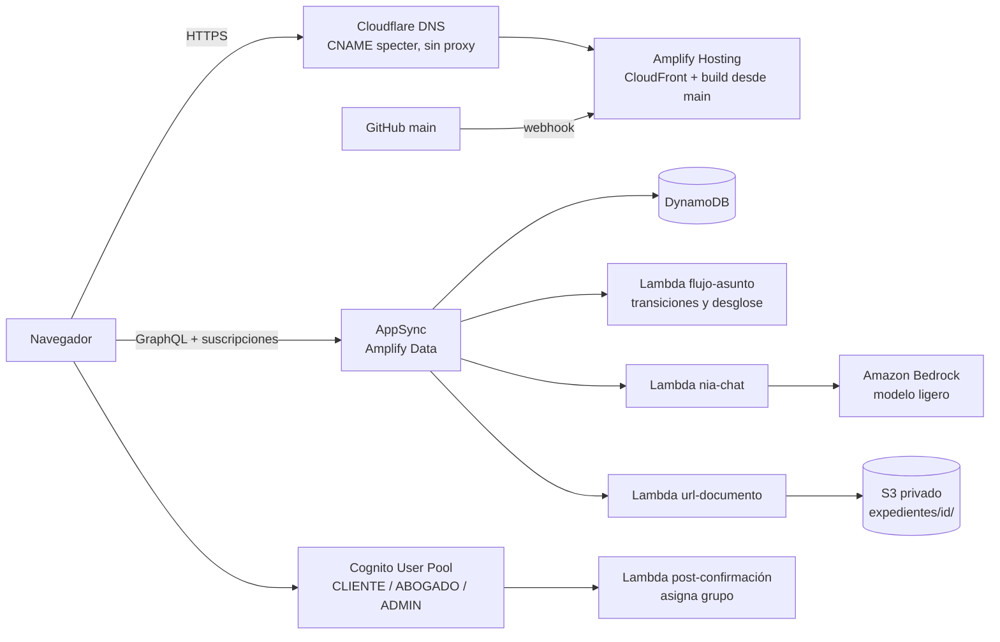
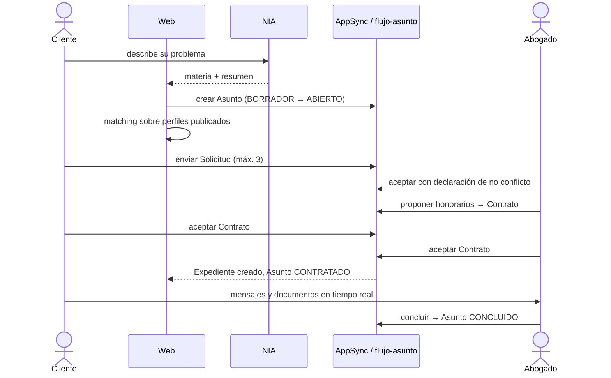

# Arquitectura del MVP

Decisiones: [ADR-0001](../adr/0001-amplify-gen2-y-terraform.md) · [ADR-0002](../adr/0002-nia-con-modelo-ligero-de-bedrock.md) · [ADR-0003](../adr/0003-autenticacion-con-cognito-y-authenticator.md)

## Vista general

## Componentes

| Componente | Responsabilidad | Tecnología |
|---|---|---|
| Web | SPA con todas las vistas por rol | React + TypeScript + Vite + React Router |
| Autenticación | Registro, sesión, grupos, MFA opcional | Cognito vía Amplify Auth, componente `Authenticator` |
| API de datos | CRUD autorizado por registro y suscripciones en tiempo real | AppSync + DynamoDB vía Amplify Data |
| `flujo-asunto` | Transiciones de estado (solicitud, aceptación, propuesta, contrato, expediente, conclusión) | Lambda (TS) como mutaciones personalizadas |
| `nia-chat` | Orientación y clasificación con salida estructurada | Lambda (TS) + Bedrock Converse API |
| `url-documento` | Verifica participación y emite URL prefirmada | Lambda (TS) + S3 |
| `post-confirmacion` | Agrega al usuario al grupo elegido (nunca `ADMIN`) | Trigger de Cognito |
| Dominio compartido | Desglose, matching, máquina de estados | `shared/domain/` (TS puro) |
| Plataforma | App de Amplify, dominio, DNS, presupuesto | Terraform (`infra/terraform/`) |

Fuera del MVP por falta de necesidad concreta: colas, procesamiento asíncrono, API REST separada y base de datos relacional.

## Autorización por modelo (resumen)

| Modelo | Lectura | Escritura |
|---|---|---|
| `PerfilAbogado` | Público si `publicado`; dueño; `ADMIN` | Dueño (salvo `publicado` y `estadoVerificacion`); `ADMIN` |
| `PerfilCliente` | Dueño; `ADMIN` | Dueño |
| `Asunto` | Dueño; abogado con solicitud | Dueño (sin `estado`) |
| `Solicitud`, `Propuesta`, `Contrato` | Cliente y abogado involucrados | Solo `flujo-asunto` |
| `Expediente` | `participantes` | Solo `flujo-asunto` |
| `Mensaje` | `participantes` | `participantes` (crear) |
| `Documento` | `participantes` | `url-documento` |
| `Actuacion` | `participantes` | Solo `flujo-asunto` (anexar) |

## Flujo principal

## Ambientes

| Ambiente | Origen | URL |
|---|---|---|
| Demostración | rama `main` | `https://specter.foor.dev` |
| Sandbox personal | `npx ampx sandbox` | local |
