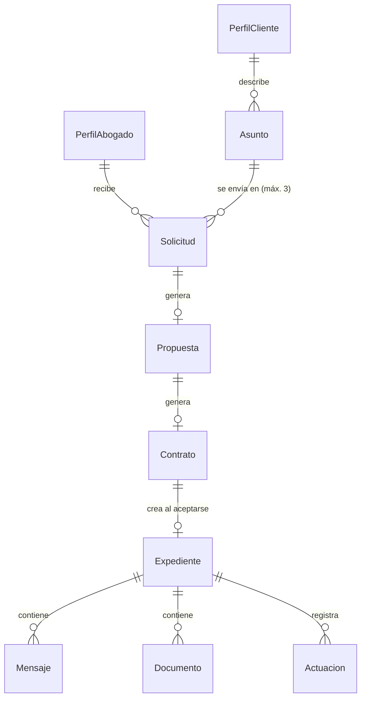
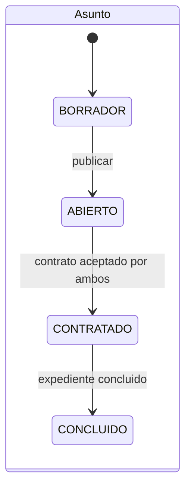
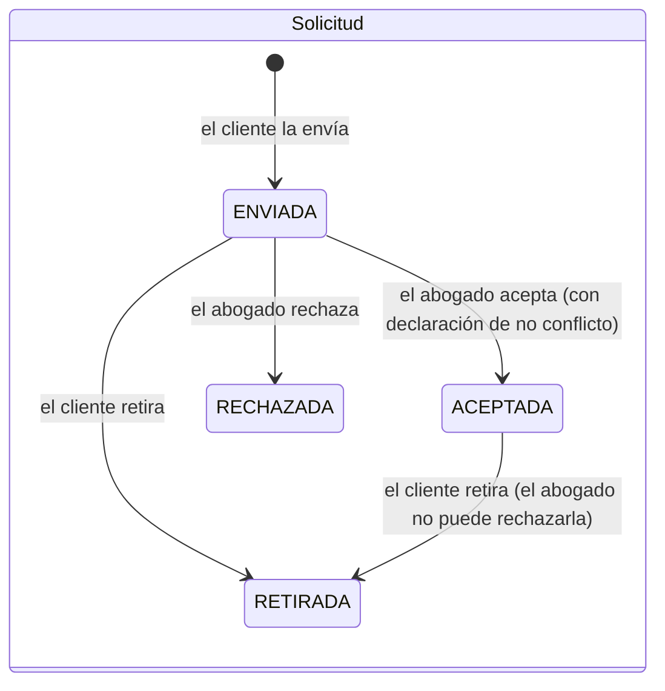

# Modelo de dominio

Ver también: [lenguaje-ubicuo.md](lenguaje-ubicuo.md) · [dudas.md](dudas.md)

## Contextos (módulos del monolito)

| Contexto | Responsabilidad | Entidades |
|---|---|---|
| Identidad y acceso | Registro, roles, sesión | Usuario de Cognito, grupos |
| Red profesional | Perfiles, publicación, verificación manual | `PerfilAbogado`, `PerfilCliente` |
| Descubrimiento | Asuntos y matching | `Asunto`, `Coincidencia` |
| Contratación | Solicitudes, propuestas, contratos, desglose | `Solicitud`, `Propuesta`, `Contrato`, `Desglose` |
| Expediente | Gestión del asunto contratado | `Expediente`, `Mensaje`, `Documento`, `Actuacion` |
| Asistencia | NIA | sin persistencia de conversaciones en el MVP |

Más adelante: **Pagos** y **Reputación**.

## Relaciones

## Estados

`Contrato`: lo prepara el cliente (`PENDIENTE`) → cada parte acepta (`aceptadoCliente`, `aceptadoAbogado` con fecha) → con la segunda aceptación, `ACEPTADO`, y se abren el expediente y su primera actuación.
`Expediente`: `EN_GESTION` → `CONCLUIDO`.

## Reglas de negocio

| ID | Regla | Origen |
|---|---|---|
| R1 | Solo `ADMIN` cambia `estadoVerificacion` y `publicado` de un perfil | Contexto, sec. VIII y XXIII |
| R2 | El perfil del cliente nunca es público | Contexto, sec. X |
| R3 | Un abogado ve un asunto solo si recibió una solicitud para él | Contexto, sec. X y XVIII |
| R4 | Un asunto `ABIERTO` puede tener como máximo 3 solicitudes activas (enviadas o aceptadas) | Decisión del MVP (validar) |
| R5 | Aceptar una solicitud exige `declaracionNoConflicto = true` con fecha | Contexto, sec. XXIV (simplificado) |
| R6 | `comision = honorarios × 0.10`; `abogadoRecibe = honorarios − comision`; el cliente paga `honorarios` (+ impuestos por definir) | Contexto, sec. XVII; decisión confirmada |
| R7 | Con ambas aceptaciones del contrato: se crea el expediente, el asunto pasa a `CONTRATADO` y las demás solicitudes pasan a `RETIRADA` | Contexto, sec. XII |
| R8 | Solo los participantes leen y escriben en el expediente | Contexto, sec. XVIII |
| R9 | Las actuaciones no se editan ni se borran | Trazabilidad, sec. XIII |
| R10 | Solo el abogado concluye el expediente | Decisión del MVP (validar) |
| R11 | Todas las transiciones de estado se ejecutan en el servidor | Constitución, principio 6 |
| R12 | NIA no presta servicios jurídicos y deriva a un abogado | Contexto, sec. XIV |
| R13 | El abogado no puede rechazar una solicitud ya aceptada; solo el cliente puede retirarla | Decisión del responsable del producto, 2026-10-23 |
| R14 | Solo se reenvía al mismo abogado si la solicitud anterior fue retirada o rechazada | Decisión del responsable del producto, 2026-10-23 |
| R15 | Al retirarse o rechazarse una solicitud, el abogado deja de leer el asunto | Contexto, sec. XVIII |
| R16 | Hay una propuesta de honorarios por solicitud; el abogado la puede actualizar mientras nadie acepte el contrato | Decisión del MVP |
| R17 | Solo el cliente prepara el contrato; cambiar la propuesta antes de cualquier aceptación descarta el contrato preparado | Decisión del MVP |
| R18 | Aceptar el contrato exige confirmar que es una aceptación de demostración sin validez jurídica | Constitución, principio 2 |
| R19 | Con la segunda aceptación: asunto contratado, solo el abogado contratado lo lee y las demás solicitudes activas quedan retiradas | Contexto, sec. XII; R7 |
| R20 | Un asunto contratado ya no admite solicitudes, retiros, rechazos ni propuestas | Decisión del MVP |

## Decisiones de implementación del modelo (T07)

| Tema | Decisión | Motivo |
|---|---|---|
| Directorio público | Modelo aparte `PerfilPublico`, copia sin cédula escrita solo por `ADMIN`; su `id` es el del `PerfilAbogado` | Las reglas de Amplify no filtran por el valor de un campo, así que `publicado` no puede abrir la lectura de `PerfilAbogado` |
| Estado del asunto | El cliente controla `abierto` (borrador o abierto); el servidor controla `etapa` (sin contratar, contratado, concluido). `estadoDeAsunto()` los combina | Cada campo tiene un solo dueño y el cliente nunca puede marcar un asunto como contratado |
| Valores iniciales | `etapa`, `estadoVerificacion` y `publicado` se guardan vacíos al crear; `etapaDe()` y `estadoVerificacionDe()` interpretan vacío como valor inicial | Un valor por defecto en un campo protegido hace fallar la creación (AppSync lo trata como escrito por el cliente) |
| Participantes | Listas `participantes` y `lectores` con la identidad `sub::username` | Reglas de propietario sobre listas |
| Administrador | No lee asuntos, contratos ni expedientes | Mínimo privilegio (contexto, sec. XVIII) |

Limitaciones conocidas: el cliente no puede eliminar un asunto (con reglas por campo, AppSync no deja borrar el registro completo; sí puede volverlo a borrador), así que eliminar o cancelar será una acción del servidor; una persona registrada como cliente puede crear un `PerfilAbogado` propio (queda sin publicar y no aparece en ningún directorio); y los cambios que un abogado haga a su perfil no llegan a `PerfilPublico` hasta que un administrador vuelva a publicarlo.

## Coincidencia entre asunto y abogado (T12)

Implementada en `shared/domain/matching.ts`. Solo se consideran los perfiles publicados. Quien no atiende la materia del asunto queda fuera; con materia «otra» ese criterio no aplica. La puntuación (0 a 100) se calcula únicamente sobre los criterios que aplican al asunto:

| Criterio | Peso provisional | Cumple | Parcial | No aplica |
|---|---|---|---|---|
| Materia | 40 | El perfil atiende la materia | | Materia «otra» |
| Ubicación | 25 | Misma ciudad | Otra ciudad pero atiende a distancia y el cliente no pidió presencial (mitad de los puntos) | |
| Modalidad | 15 | El perfil ofrece la modalidad pedida | | El cliente no tiene preferencia |
| Presupuesto | 15 | Los rangos se traslapan | | El cliente o el perfil no indican rango |
| Verificación | 5 | Verificado manualmente | | |

Empates: primero el verificado, luego más años de experiencia y luego el nombre. Cada criterio devuelve un texto que explica por qué coincide o no. Se comparan de 2 a 3 perfiles a la vez.

## Catálogo de materias (propuesta a validar)

Civil · Familiar · Mercantil · Laboral · Penal · Administrativo · Fiscal · Amparo y constitucional · Otra.
