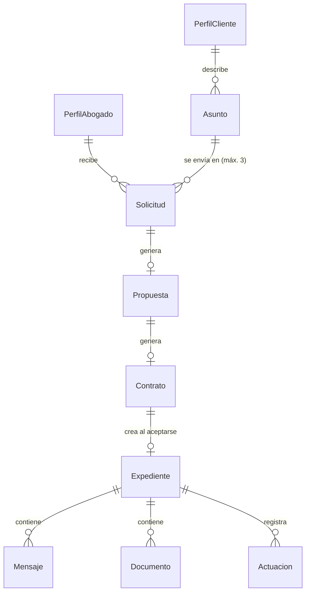
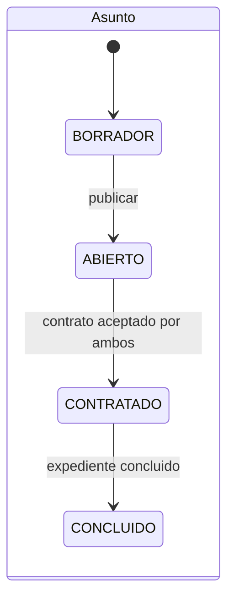
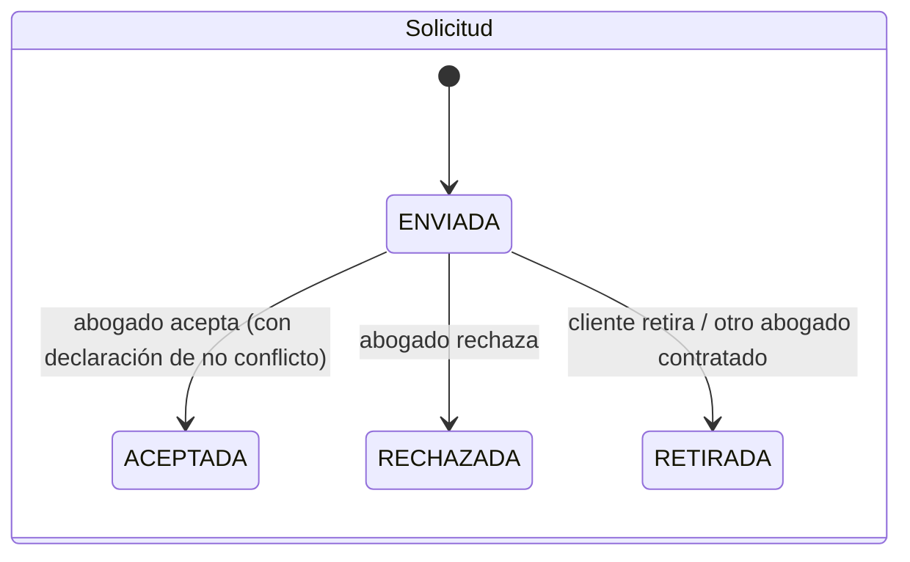

# Modelo de dominio

Ver también: [lenguaje-ubicuo.md](lenguaje-ubicuo.md) · [dudas.md](dudas.md)

## Contextos (módulos del monolito)

| Contexto | Responsabilidad | Entidades |
|---|---|---|
| Identidad y acceso | Registro, roles, sesión | Usuario de Cognito, grupos |
| Red profesional | Perfiles, publicación, verificación manual | `PerfilAbogado`, `PerfilCliente` |
| Descubrimiento | Asuntos y matching | `Asunto`, `Coincidencia` |
| Contratación | Solicitudes, propuestas, contratos, desglose | `Solicitud`, `Propuesta`, `Contrato`, `Desglose` |
| Expediente | Gestión del asunto contratado | `Expediente`, `Mensaje`, `Documento`, `Actuacion` |
| Asistencia | NIA | sin persistencia de conversaciones en el MVP |

Más adelante: **Pagos** y **Reputación**.

## Relaciones

## Estados

`Contrato`: `PENDIENTE` → (`aceptadoCliente` y `aceptadoAbogado` con fecha) → `ACEPTADO`.
`Expediente`: `EN_GESTION` → `CONCLUIDO`.

## Reglas de negocio

| ID | Regla | Origen |
|---|---|---|
| R1 | Solo `ADMIN` cambia `estadoVerificacion` y `publicado` de un perfil | Contexto, sec. VIII y XXIII |
| R2 | El perfil del cliente nunca es público | Contexto, sec. X |
| R3 | Un abogado ve un asunto solo si recibió una solicitud para él | Contexto, sec. X y XVIII |
| R4 | Un asunto `ABIERTO` puede tener como máximo 3 solicitudes activas | Decisión del MVP (validar) |
| R5 | Aceptar una solicitud exige `declaracionNoConflicto = true` con fecha | Contexto, sec. XXIV (simplificado) |
| R6 | `comision = honorarios × 0.10`; `abogadoRecibe = honorarios − comision`; el cliente paga `honorarios` (+ impuestos por definir) | Contexto, sec. XVII; decisión confirmada |
| R7 | Con ambas aceptaciones del contrato: se crea el expediente, el asunto pasa a `CONTRATADO` y las demás solicitudes pasan a `RETIRADA` | Contexto, sec. XII |
| R8 | Solo los participantes leen y escriben en el expediente | Contexto, sec. XVIII |
| R9 | Las actuaciones no se editan ni se borran | Trazabilidad, sec. XIII |
| R10 | Solo el abogado concluye el expediente | Decisión del MVP (validar) |
| R11 | Todas las transiciones de estado se ejecutan en el servidor | Constitución, principio 6 |
| R12 | NIA no presta servicios jurídicos y deriva a un abogado | Contexto, sec. XIV |

## Catálogo de materias (propuesta a validar)

Civil · Familiar · Mercantil · Laboral · Penal · Administrativo · Fiscal · Amparo y constitucional · Otra.
